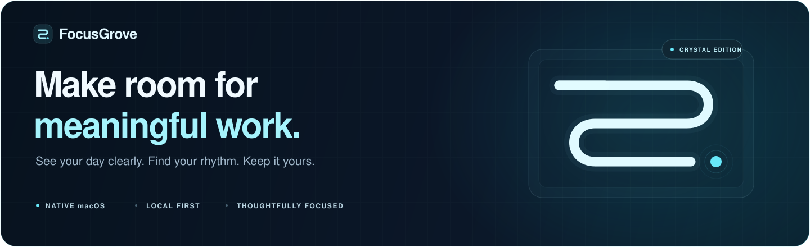
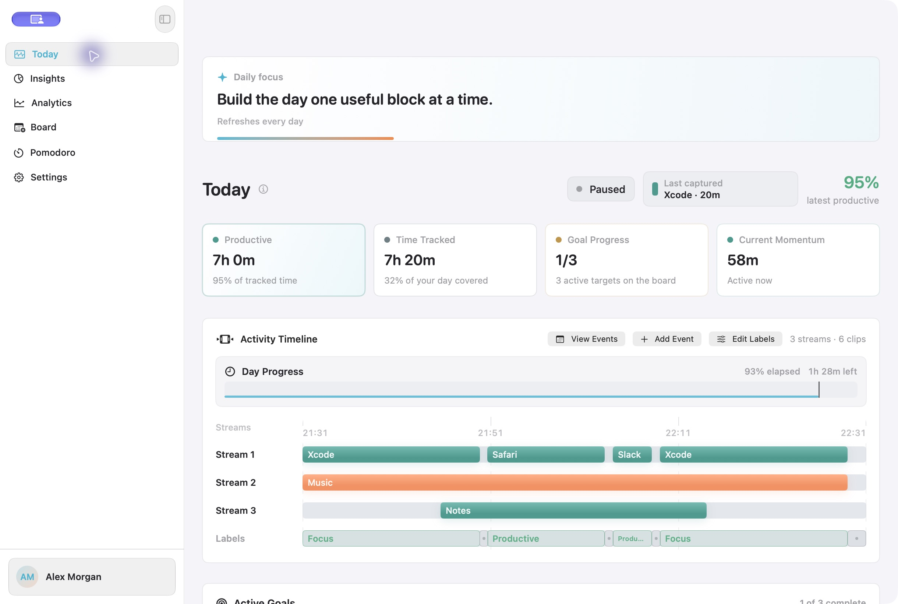
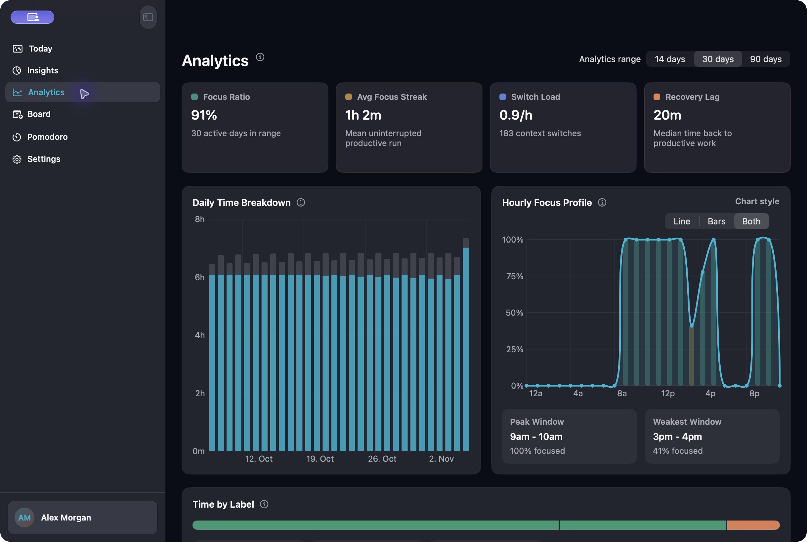
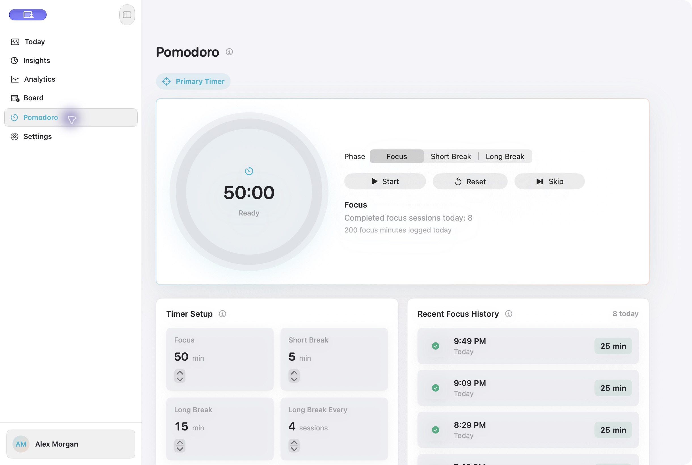
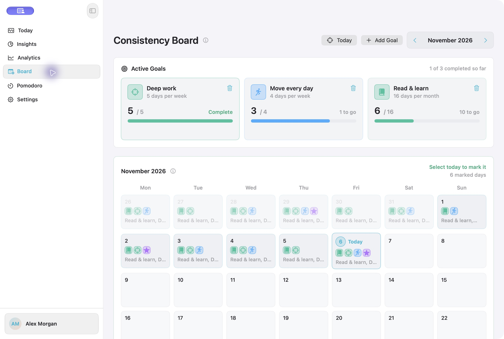
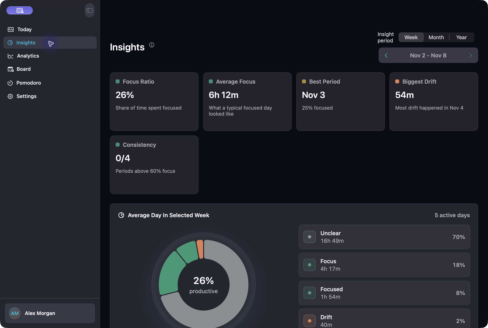
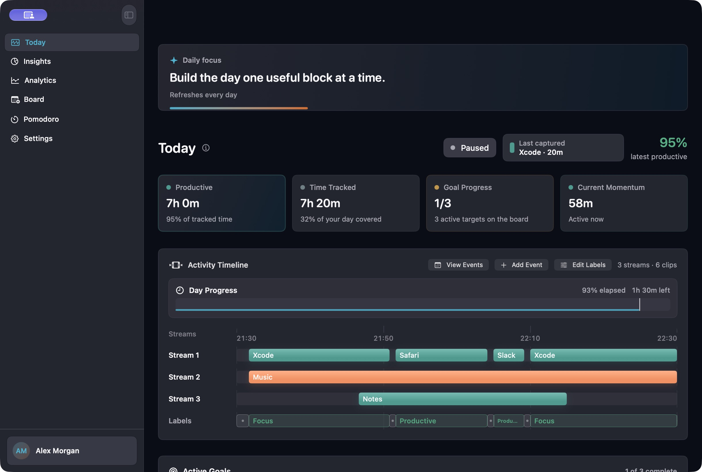
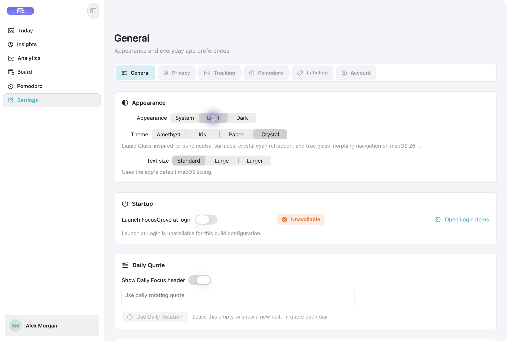

<p align="center">
  
</p>

<p align="center">
  <strong>Understand your day. Protect your focus. Build a rhythm that lasts.</strong><br>
  A native Mac app for activity tracking, thoughtful reflection, focus sessions, and everyday goals.
</p>

<p align="center">
  
  
  
  
</p>

<p align="center">
  <a href="#a-look-inside">Screenshots</a> ·
  <a href="#everything-you-need-for-a-more-intentional-day">Features</a> ·
  <a href="#the-research-behind-the-rhythm">Research</a> ·
  <a href="#run-it-on-your-mac">Get started</a>
</p>

<br>



<p align="center"><sub>Crystal in white. Real app screenshots throughout; all activity, names, and goals shown are synthetic demonstration data.</sub><br><sub><a href="docs/screenshots/today-crystal-light.png">Explore the light dashboard</a> · <a href="docs/screenshots/today-crystal.png">Explore the dark dashboard</a></sub></p>

## A clearer picture of your time

Work rarely happens in a single window. You might be writing code with documentation beside it and music in the background. FocusGrove preserves that context with simultaneous activity streams, then uses primary attention for its analytics so overlapping apps do not inflate your tracked hours.

See what happened, adjust what it means, and decide what deserves your next block of attention. Your activity stays on your Mac.

| When you want to… | FocusGrove gives you… |
| :--- | :--- |
| Understand where the day went | Automatic app tracking, a visual timeline, and an inspectable activity audit |
| Find your best working rhythm | Hourly focus patterns, daily trends, focus stretches, and app-switching metrics |
| Start a focused session quickly | A Pomodoro timer and a pull-down timer in the menu bar |
| Make goals visible | A calendar board, daily check-ins, and weekly or monthly targets |
| Keep your own definition of productive | Custom labels, per-app rules, and editable timeline overlays |
| Stay in control of your history | Local storage, CSV export, JSON backup and restore, and clear-data controls |

## A look inside

<table>
  <tr>
    <td width="50%">
      <a href="docs/screenshots/analytics-crystal.png"></a>
      <p><strong>Find your patterns</strong><br><sub>Explore 14, 30, or 90 days of activity.<br><a href="docs/screenshots/analytics-crystal-light.png">Light</a> · <a href="docs/screenshots/analytics-crystal.png">Dark</a></sub></p>
    </td>
    <td width="50%">
      <a href="docs/screenshots/pomodoro-crystal-light.png"></a>
      <p><strong>Give focus a little structure</strong><br><sub>Work, rest, and start again at your pace.<br><a href="docs/screenshots/pomodoro-crystal-light.png">Light</a> · <a href="docs/screenshots/pomodoro-crystal.png">Dark</a></sub></p>
    </td>
  </tr>
  <tr>
    <td width="50%">
      <a href="docs/screenshots/board-crystal-light.png"></a>
      <p><strong>Make consistency visible</strong><br><sub>Turn small check-ins into a history you can see.<br><a href="docs/screenshots/board-crystal-light.png">Light</a> · <a href="docs/screenshots/board-crystal.png">Dark</a></sub></p>
    </td>
    <td width="50%">
      <a href="docs/screenshots/insights-crystal.png"></a>
      <p><strong>Reflect beyond today</strong><br><sub>Step through your weeks, months, and years.<br><a href="docs/screenshots/insights-crystal-light.png">Light</a> · <a href="docs/screenshots/insights-crystal.png">Dark</a></sub></p>
    </td>
  </tr>
</table>

<details>
<summary><strong>Crystal after dark — see the full dashboard</strong></summary>



</details>

## Everything you need for a more intentional day

### See the day as it happened

- **Automatic foreground tracking.** Capture app sessions without keeping a manual stopwatch for every switch.
- **Simultaneous streams.** Keep meaningful visible companion windows and supported background audio activity alongside the frontmost app.
- **Interactive timeline.** Inspect activity clips and move through recent history in a configurable 10–60 minute window.
- **Day and waking progress.** See the shape of the day, with an option to fold sleep out of the progress view.
- **Manual events.** Add planned activities, recurring events, weekday schedules, sleep blocks, and optional reminders.
- **Recent audit.** Review captured activity and remove individual entries.
- **Tracking controls.** Pause tracking, tune idle detection and sampling, or track only an app allowlist.

### Make the numbers mean something to you

- **Today at a glance.** Productive time, tracked time, goal progress, and current or best productive stretch.
- **Editable labels.** Reclassify timeline intervals without rewriting the original captured activity.
- **Your categories.** Use built-in labels or create labels with custom names, colors, and symbols.
- **Per-app rules.** Decide how individual apps contribute to your productivity picture; review unknown apps as they appear.
- **Week, month, and year reflections.** Browse period summaries, average-day breakdowns, grouped history, and goal progress.
- **14 / 30 / 90-day analytics.** Explore daily trends, hourly focus profiles, label distribution, and top apps.
- **Focus and switching metrics.** Inspect average and longest productive stretches, app switches per tracked hour, and median gaps from unproductive activity back to productive activity.
- **Milestones.** Follow productive streaks, focus stretches, completed goals, Pomodoro cycles, and your top productive app.

<details>
<summary><strong>How the metrics work</strong></summary>

Productivity depends on your labels and rules. These metrics describe recorded app activity; they do not measure the quality of your work.

- Primary-attention analytics exclude companion streams, sleep, and lifecycle context to avoid double-counting elapsed time.
- A focus stretch is a merged productive interval; it is not a direct measurement of cognitive attention.
- An app switch counts a transition between different app bundle identifiers in the normalized primary timeline. It is not necessarily an interruption.
- The recovery metric is a time gap from the end of an unproductive segment to the start of a subsequent productive segment. It does not measure psychological recovery.
- Manual label edits remain overlays on top of raw activity, so the captured record and your interpretation remain separate.

See the [analytics engine](Productivity/Core/Services/Insights/AdvancedAnalyticsEngine.swift) and [timeline models](Productivity/Core/Models/TimelineModels.swift) for the implementation.

</details>

### Start focus with a gesture

- **Pull-to-start menu bar timer.** Drag down from the timer icon to choose a focus duration from 1 minute to 3 hours; longer durations use larger steps.
- **Live menu bar countdown.** Check remaining time and a progress ring while working in another app.
- **Flexible Pomodoro sessions.** Start with 25-minute focus, 5-minute short breaks, and 15-minute long breaks, with a long break after four focus sessions. Customize the durations and cadence.
- **Simple controls.** Start, pause, reset, select a phase, or skip ahead. Completed phases automatically advance.
- **Session history.** Review completed focus sessions and accumulated focus minutes.
- **Sound cues.** Choose locally generated tones for focus, breaks, and completion, or keep things silent.

### Build routines you can actually see

- **Calendar board.** Browse months and pin markers to individual days.
- **Weekly and monthly goals.** Set a target count for deep work, exercise, study, or a custom activity.
- **Custom markers.** Use built-in symbols or your own goal symbols.
- **Progress where you need it.** See goal summaries on Today and in period reflections.
- **Desktop widgets.** Productivity Overview shows tracked time, focus score, and Pomodoro status; Today's Goals shows weekly and monthly progress with interactive completion controls.
- **Widget navigation.** Open the relevant app view directly from a widget.

### Make it feel at home on your Mac

- **Four themes.** Crystal, Amethyst, Iris, and Paper, with system, light, and dark appearance modes.
- **Crystal glass.** Translucent surfaces, cyan accents, and glass navigation on supported macOS versions.
- **Comfortable reading.** Three text sizes and adaptive layouts for different window widths and fullscreen.
- **A daily focus note.** Start with a rotating quote or write your own reminder.
- **Native convenience.** Launch at login, menu bar access, and dashboard reopening from the Dock.
- **Local profile.** Choose a display name without creating an online account.

<details>
<summary><strong>See the appearance controls</strong></summary>

Choose **Settings → General → Theme → Crystal**, then select **Light**, **Dark**, or **System** under Appearance.



</details>

## The research behind the rhythm

The app brings together progress monitoring, regular breaks, and visible repetition. Here is what published research says about those practices.

| Practice | Actual research numbers | What that means for the app |
| :--- | :--- | :--- |
| **Monitor progress** | A meta-analysis of **138 studies**, covering **19,951 participants**, found a goal-attainment effect of **d = 0.40**, with a **95% confidence interval of 0.32–0.48**.[^monitoring] | Goal counts, calendar check-ins, and period reviews make progress easier to revisit. |
| **Make room for breaks** | A meta-analysis of **22 independent samples**, totaling **2,335 participants**, found small benefits for vigor (**d = 0.36**) and fatigue reduction (**d = 0.35**). The overall performance effect (**d = 0.16**) was **not statistically significant**.[^breaks] | Customizable focus and break cycles provide a practical cue to pause. This study does not establish an optimal 25/5 schedule. |
| **Give routines time** | A **12-week study of 96 volunteers** modeled habit formation. Estimated time to reach 95% of the automaticity plateau ranged from **18 to 254 days**; missing one opportunity did not materially affect the process.[^habits] | Weekly and monthly goals help you see repeated actions over time without assuming everyone follows the same timetable. |

**Reading the numbers:** *d* is a standardized effect size, not a percentage increase. These studies examined behaviors and interventions across their own samples; they did not test FocusGrove. The feature connections above explain the design rationale, not a measured productivity gain from this app.

## Your activity belongs on your Mac

FocusGrove stores activity locally and does not upload it to an app backend. Core tracking, analytics, goals, and timers work without an online account.

| Area | Current behavior |
| :--- | :--- |
| **Activity history** | SQLite storage on your Mac, with write-ahead logging and legacy data migration |
| **What tracking reads** | Foreground app identity, window metadata, and supported audio-process activity |
| **Screen content** | No screen recording, screenshot capture, or Accessibility-based window-title reading |
| **Permissions** | Current tracking does not request Screen Recording or Accessibility access; notifications are optional for reminders |
| **Export** | CSV for inspection and JSON backup for restoring app data |
| **Control** | Pause tracking, choose an app allowlist, delete individual activity entries, restore a backup, or clear local data |

The screenshots in this README were captured separately for documentation using a sample-data build. Screenshot capture is not a feature of the activity tracker.

## Run it on your Mac

This repository contains the **Productivity** Xcode project; the app's display name is **FocusGrove**. The current project targets **macOS 26.5 or later**.

### Build with Xcode

1. Install Xcode with an SDK that supports the project's macOS deployment target.
2. Clone the repository and open the project:

   ```bash
   git clone https://github.com/sonarpratik5/Productivity.git
   cd Productivity
   open Productivity.xcodeproj
   ```

3. Select the **Productivity** scheme and **My Mac** destination.
4. Set your development team under **Signing & Capabilities** for the app and widget extension. If you change bundle identifiers, configure the shared App Group consistently for both targets.
5. Build and run with **⌘R**. Notification access can be skipped if you do not need event reminders.

For a local build without code signing:

```bash
xcodebuild \
  -project Productivity.xcodeproj \
  -scheme Productivity \
  -configuration Debug \
  -derivedDataPath /tmp/FocusGroveBuild \
  CODE_SIGNING_ALLOWED=NO \
  build
```

Desktop widget installation and shared App Group behavior require appropriate signing and entitlements.

### Your first few minutes

1. Open **Settings → Labeling** and choose automatic app coverage or a manual app allowlist.
2. Give your everyday apps labels that reflect how you use them.
3. Add one weekly goal on **Board**.
4. Start a focus session from **Pomodoro** or pull down from the menu bar timer.
5. Return to **Today**, then use **Insights** and **Analytics** as your history grows.

## Under the hood

| Layer | Implementation |
| :--- | :--- |
| **Interface** | SwiftUI, AppKit, Swift Charts, and Observation |
| **Activity capture** | `NSWorkspace`, window metadata, and CoreAudio process activity where supported |
| **Storage** | SQLite repositories, local preferences, and versioned JSON backups |
| **Focus timer** | An observable timer model, AppKit status item, and interactive pull overlay |
| **Widgets** | WidgetKit and App Intents with shared snapshots |
| **Validation** | Swift Testing and XCTest coverage for persistence, labels, timelines, analytics, backups, timers, and UI flows |

<details>
<summary><strong>Explore the source</strong></summary>

```text
Productivity/
├── App/                 Dependency setup, preferences, architecture notes
├── Core/
│   ├── Models/          Activity, labels, events, and timeline models
│   ├── Persistence/     Activity and label repositories
│   ├── Services/        Tracking, classification, and analytics
│   └── Utilities/       CSV export, backups, and formatting
├── Features/
│   ├── Dashboard/      Today, navigation, and milestones
│   ├── Timeline/       Activity streams, events, and label editing
│   ├── Insights/       Analytics and daily insight cards
│   ├── Week/           Week, month, and year reflections
│   ├── Calendar/       Board and goals
│   ├── Pomodoro/       Focus timer and menu bar interaction
│   └── Settings/       Appearance, privacy, tracking, and labels
└── Shared/             Theme, reusable UI, and widget snapshots
ProductivityWidgets/    Desktop widgets and goal completion intents
ProductivityTests/      Model, persistence, and behavior tests
ProductivityUITests/    App interaction tests
```

Read the [architecture notes](Productivity/App/Architecture.md), [app handoff](handoff.txt), and [test inventory](tests.md) for more detail. The test inventory records a historical run, not a live CI result.

</details>

---

<p align="center"><strong>A little more awareness. A little more intention. A day that feels like yours.</strong></p>

[^monitoring]: Harkin, B., et al. (2016). *Does Monitoring Goal Progress Promote Goal Attainment? A Meta-Analysis of the Experimental Evidence.* Psychological Bulletin, 142(2), 198–229. [Author manuscript and abstract](https://eprints.whiterose.ac.uk/id/eprint/91437/) · [DOI: 10.1037/bul0000025](https://doi.org/10.1037/bul0000025).
[^breaks]: Albulescu, P., et al. (2022). *“Give me a break!” A systematic review and meta-analysis on the efficacy of micro-breaks for increasing well-being and performance.* PLOS ONE, 17(8), e0272460. [Open-access paper](https://journals.plos.org/plosone/article?id=10.1371/journal.pone.0272460). The vigor and fatigue estimates use nine samples each (n = 913 and n = 803); the overall performance estimate uses 15 samples (n = 1,132). The 2,335 figure is the total across all 22 independent samples.
[^habits]: Lally, P., van Jaarsveld, C. H. M., Potts, H. W. W., & Wardle, J. (2010). *How are habits formed: Modelling habit formation in the real world.* European Journal of Social Psychology, 40(6), 998–1009. [Publisher abstract](https://onlinelibrary.wiley.com/doi/abs/10.1002/ejsp.674). Of 96 volunteers, 82 provided sufficient data; models fitted 62 individuals, with a good fit for 39. The 18–254-day range is a modeled estimate, including extrapolation beyond the 84-day observation period.
